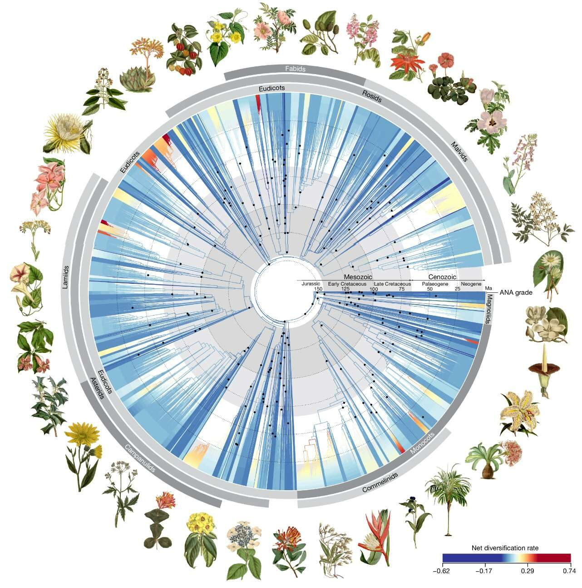

Para iniciar tu postulación y participar en nuestro proceso de selección, por favor completa el [siguiente formulario](https://nextcloud.datadiversitylab.synology.me/apps/forms/s/ybJmkt7cW7o4nHF3nQs49nFx).

Las fotos de cada taller están disponibles en la [galería](/macrodata/galeria/).

