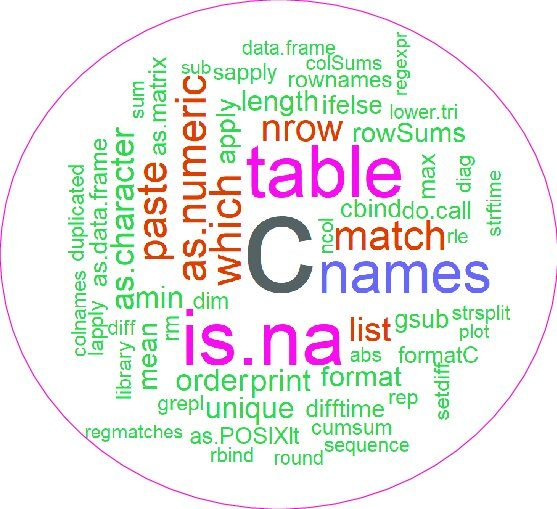
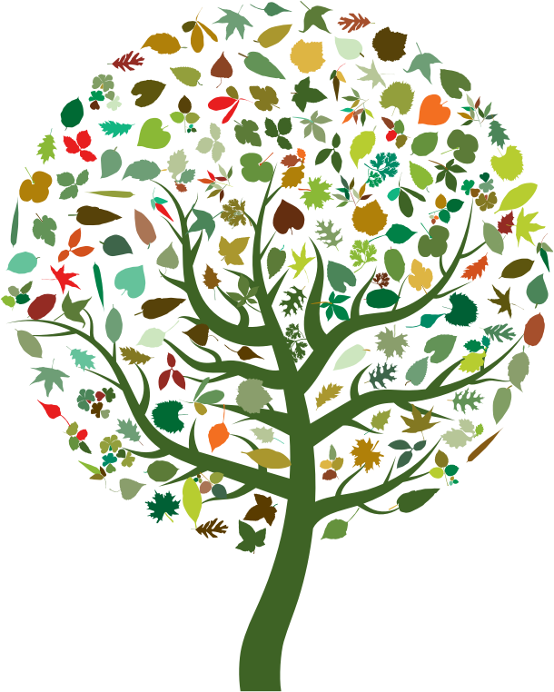
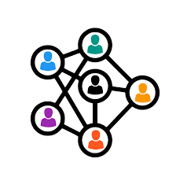

## 1. Explorar R desde cero

Durante los cursos, exploraremos los fundamentos de programación y ciencia de datos en R, partiendo desde lo más básico. Los cursos estarán basados en herramientas y ejemplos diseñados especialmente para un aprendizaje práctico, aplicado y conectado con la biología evolutiva.

## 2. Aplicar métodos comparativos filogenéticos

Abordaremos conceptos clave en macroevolución utilizando herramientas recientes en el campo. Este enfoque nos permitirá construir y analizar filogenias con datos reales, haciendo énfasis en cómo aplicar estos métodos a preguntas evolutivas concretas.

## 3. Crear comunidad

Más allá de los contenidos técnicos, MacroData busca generar lazos entre los asistentes. Queremos que compartan ideas, se apoyen en nuevos proyectos y continúen conectados durante, y después de la participacion en los talleres. Creemos que la comunidad científica crece cuando sus integrantes se escuchan, colaboran y se acompañan.

## 4. Publicar juntos

Uno de los resultados concretos del curso será una publicación científica colaborativa. Queremos que quienes participen se involucren en todas las etapas del análisis, subsecuentemente en la escritura, y que figuren como coautores de un trabajo producto del aprendizaje colectivo.

## 5. Dejar huella digital

Todo lo aprendido y construido en MacroData vivirá en esta plataforma digital abierta. Aquí reuniremos materiales de los talleres, scripts, herramientas, guías y todos los logros del proyecto. Será un espacio para permitir que experiencias similares tengan una estructura mas simple para iniciar.

---

## Resultados esperados

- Capacitación práctica de al menos **80 estudiantes e investigadores** de diferentes regiones.
- **Filogenias calibradas en el tiempo** de grupos biológicos poco estudiados.
- **Publicación científica colectiva** con coautoría de los participantes del curso.
- **Plataforma digital abierta** con recursos en español: scripts, guías, presentaciones, materiales del taller y herramientas desarrolladas durante el proyecto.
- **Mayor participación de investigadores colombianxs** en el desarrollo de herramientas bioinformáticas y ciencia abierta.
- **Red activa de estudiantes e investigadores**, conectados a través de Mattermost, para seguir aprendiendo y colaborando luego del curso.
